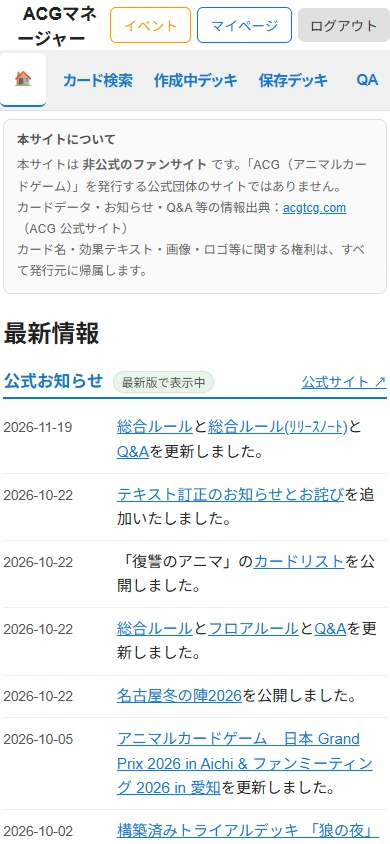
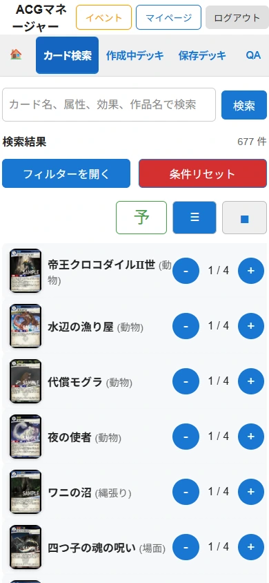
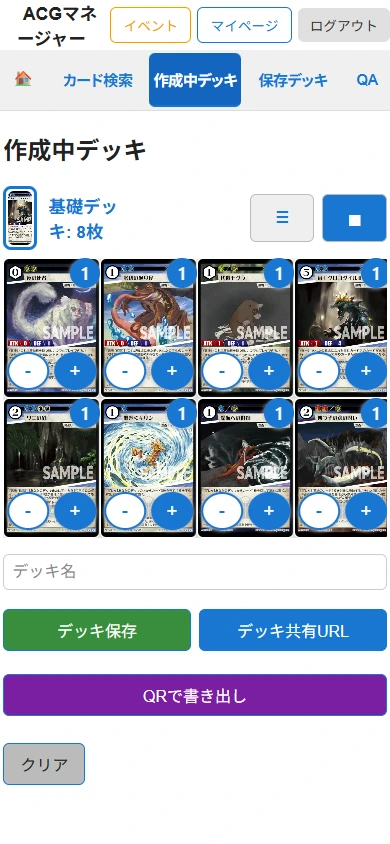

# ACGマネージャー

ACG（アニマルカードゲーム）のカードを検索し、デッキを組んで保存・共有できる個人開発のWebアプリです。カード追加や再録でデータが更新されても、以前に保存したデッキを読み込めるようにしています。

※本作は個人開発した非公式のファンサイトで、営利利用しているものではありません。

## スマートフォンでの操作画面

### 公式情報をまとめたホーム

公式のお知らせ、新製品、公認イベントをホームに集約しています。初回表示にはビルド時に取得した情報を使い、ホームを開いたときに取得できた最新情報へ更新します。[お知らせ欄の実装](src/components/HomeOfficialNews.jsx)



### カード検索とデッキ構築

| カード検索 | デッキ構築 |
| --- | --- |
|  |  |

## できること

- 一覧やグリッドからカードを探し、採用する枚数を調整してデッキを組む。
- デッキを保存し、共有URL・QRコードやJSON・PNG・PDFで持ち出す。

## 開発で担当したこと

個人開発として、目的と仕様の整理、AIへの実装指示、改善方針の判断、動作確認を担当しました。コード作成にはAIを活用しています。

## 設計の工夫

- **保存デッキの互換性を保つ。** 以前はカードの通し番号が新弾追加でずれ、保存デッキのカードが別のカードに置き換わることがありました。固定ID表を導入し、旧形式のIDや再録カードのIDを読み込み時に対応するカードへ変換します。[固定ID表](scripts/card-id-map.json) · [旧IDの移行処理](src/utils/deckIdMigration.js)
- **公式情報の更新途中を扱う。** 商品ページに画像だけが先行掲載された場合は確認済み情報を補い、公式カードリストに詳細テキストが加わったらそちらを優先します。再録の統合や取り込みをテストで確認します。[カード取り込みテスト](scripts/test-card-import.mjs) · [再録の移行テスト](scripts/test-reprint-migration.mjs)

**主な技術**　JavaScript、React、Vite、jsPDF

## 開発サーバー起動方法

```bash
npm ci
npm run dev
```

## ビルド方法
```
npm run build
```

## カード ID のルール（重要）

デッキ（localStorage / Supabase / 共有URL / イベント登録）はカードを **数値 ID** で保存している。
そのため **既存カードの ID は絶対に変えてはいけない**。

- ID は `scripts/card-id-map.json`（kindKey → ID の固定表）で管理する。
  - 既存カード: 表の値をそのまま使う（不変）
  - 新カード: `scripts/card-ids.mjs` の `formulaCardId()` がカード番号から決定的に採番し、表に追記される
- `npm run generate-card-data` を実行したら、`src/cardData.generated.js` と
  **`scripts/card-id-map.json` を必ず一緒にコミットする**。
- `npm run check-card-ids` で「ID がずれていないか」を検証できる（prebuild でも自動実行）。

過去は「弾順に並べた通し番号」を ID にしていたため、新弾が出るたびに最後尾の領土カード
(RYO-###) の ID がずれ、保存済みデッキの領土デッキが別カードに化けていた。
その世代のデッキは `src/utils/deckIdMigration.js` が読み込み時に自動で現行 ID へ復元する。

## 画像が先行公開された弾の取り込み

BP6「復讐のアニマ」は、公式カードリストより先に商品ページで画像が公開されたため、商品ページから取り込む。
カード名・コスト・条件・タイプ・種属・ATK/DEF は画像で確認した値を
`scripts/card-image-details.json` に保存している。効果本文が未収録のカードは
詳細画面で画像参照を案内し、効果検索の対象には含めない。

公式カードリストにテキストが追加されると、自動発見した詳細ページの情報を優先する。
BP6の同名再録と基礎領土の絵違いは除外し、「巡行する蠍」はカード記載の8枚上限を適用する。

`scripts/acg-cardlists.mjs` はカードリストのナビに加え、公式の商品一覧・トップページから
商品ページを自動発見する。カードリスト未掲載でも、名前を確認済みの通常版カードをビルド時に取り込む。
これはビルド時の更新であり、公開サイトが定期的に再取得する仕組みではない。
カードリストと複数の商品ページに同じカードが載っても、カード番号（エラータ違いを
除いた `kindKey`）で1種類に統合する。詳細テキストを優先し、画像補完で上書きしない。

構築済みトライアルデッキ「狼の夜」「狸の宴」「猫の戯」は、各7種、計21種の新規カードのみ収録。
`scripts/trial-decks.json` に画像で確認した基本情報と、再録47種の対応先を保存する。
再録・F加工版・ランダムPR版は画像取得とカード生成の両方から除外する。
効果本文は画像を参照し、公式詳細テキストが公開されたらそちらを優先する。
収録デッキは掲載ページから判定するため、TDの通し番号が増えても既存のカードIDは変わらない。
`npm run test:card-import` で商品発見・再録除外・新規カードの収録を検証できる。

再録除外はTDに限定しない。`scripts/card-reprints.json` に既知のBP・SD・領土再録を記録し、
未登録の再録も全弾のカード名で照合する。元カードの詳細情報を優先し、同名カードを重複表示しない。
除外したカードのIDは固定表に残し、生成データの `cardIdAliases` / `cardNumberAliases` で
保存デッキ・共有URL・イベント登録・外部QRを元カードへ読み替える。元版と再録が混在する場合は
枚数を合算する。「運命の帰郷」はエラータ版を残す。

ビルドではHTMLを一度だけ取得してカードを統合し、採用したカードの画像だけを取得する。
名前未確認の画像は新規か再録か判別できないため、`[deferred]` ログに出して保留する。
公式の詳細ページが公開されるか、画像を確認して上記の基本情報JSONへ登録すると取り込まれる。
自動判定した再録の対応先は生成ファイルから次回へ引き継ぎ、既存の採用番号を優先する。

通信にはタイムアウトと再試行を設け、HTMLの取得失敗時には保存済みキャッシュを使う。
既存カード・訂正版・詳細が欠落する更新や、必要画像の取得失敗はビルドエラーにする。
`node scripts/fetch-acg-images.mjs --dry-run` で生成ファイルを変更せず取得対象を確認できる。
`--offline` はHTML・画像とも保存済みデータだけを使い、欠けていても通信しない。
`--force` で画像を再取得して内容が変わった場合は、次のWebP変換で画像も更新される。

## 性能改善とローカル検証（2026-10-08）

Node.js 22.12以降の22系を使用。

```sh
npm ci --ignore-scripts
npm run harness:preflight
npm run harness:check
```

`harness:check` はテスト・lint・ビルド・配布画像とPDF分割の検査を実行する。Node、開始時のHEAD、ソースのSHA-256、所要時間、成否を `.codex-temp/harness/latest.json` に記録し、検証中にソースが変われば失敗する。結果の再利用による検査省略はしない。開発ポートは5173（PORT指定可）に固定し、使用中なら停止する。

一覧・グリッドの行、検索結果、描画用データとコールバックを再利用し、採用枚数の参照にMapを使う。レイアウト・カードID・出力操作は維持。jsPDFはPDF操作時に読み込み、配布検査で初期読み込みに混入していないことを確認する。

既存の品質82のWebP変換を維持し、配布時にWebPの形式・寸法・容量を確認して参照先と内容ハッシュを確定する。元画像と既存の直接URLは保持する。public/images/toliming temp/はローカル検証用なので配布対象から除く。その他のpublicファイル（_redirects等）は保持する。NetlifyのNodeも22系に統一。

通常のnpm run buildには公式データ取得と既存のクラウド照合が含まれる。npm run checkでは保存済みデータだけを使うbuild:offlineを実行し、カードID固定表と既存の取り込みテストも検査する。保存済み画像・HTMLが必要で、公式サイトやクラウドへの実接続はこの検証には含まない。

Chromiumの独立プロファイルで1280px／390pxの検索・枚数変更時の画像DOM維持・ゲストの保存と再読込・JSON／PNG／PDFダウンロード・PDF遅延読込を確認。外部リクエストはスタブ化したため、認証・クラウド保存・公式データの実接続やAndroid実機を確認したものではない。一時ブラウザ検証スクリプト・結果は作業用フォルダに保存し、配布物には含めない。

## 認証情報の混入防止

初回 clone 後は `npm run security:install` を実行してください。検査と検出時の対応は [SECURITY.md](SECURITY.md) を参照してください。

## 関連作品

- [幻想符 Simulator](https://github.com/shikuto3194/orica-simulator-interview)
- [オリカマネージャー](https://github.com/shikuto3194/orika-react-interview)
- [TCG マネージャー](https://github.com/shikuto3194/tcg-react)
